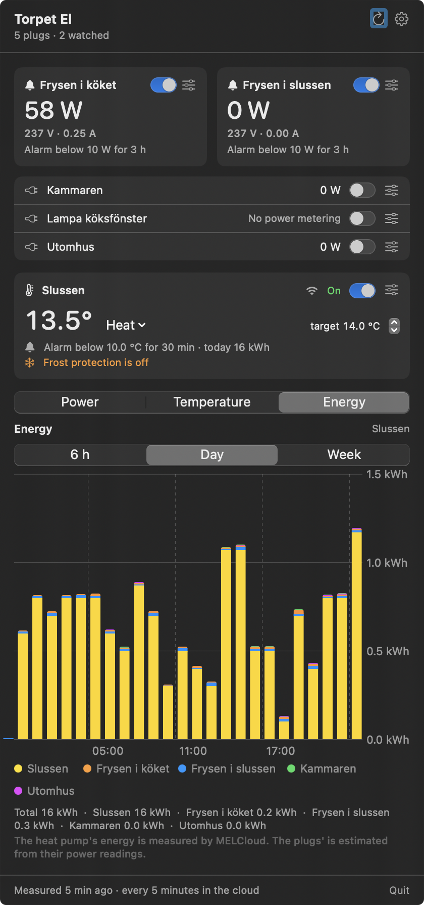

# Torpet El

A macOS menu bar app that watches the Tuya/Smart Life smart plugs at our summer cottage ("torpet") and raises an
alarm when a freezer stops drawing power. It also watches the Mitsubishi air-to-air heat pump through MELCloud Home,
so the water pipes don't freeze. The watching itself runs in AWS (see [cloud/](cloud/README.md)), so alarms
reach your phone through ntfy even when the Mac is asleep or off. The app shows what the cloud sees.

<p align="center"></p>

The menu bar shows the watched plugs' current power and the heat pump's room temperature, for example
`⚡ 84 W  63 W  12,5°`, and switches to `⚠` when something is wrong. Click it to see:

- **The plugs**: the watched ones (the freezers) as tiles side by side with on/off switch, online status, power, voltage
  and current, the others as one line each.
- **Alarm settings** per plug: below how many watts it counts as having no power, how long it may stay that way,
  and whether to alarm when the plug goes offline (power cut, tripped fuse, network down at the cottage).
- **The heat pump**: room temperature, mode, target temperature, Wi-Fi signal, energy used today, and its alarm,
  frost protection and holiday mode status. You can switch it on and off, change the mode and target, and set the
  fan, frost protection and holiday mode.
- **Charts** for the last 6 hours, day or week. *Power* shows every plug with power metering in its own color, with
  each plug's average power; pick a single plug to see its alarm limit and how much of the time the compressor ran.
  *Temperature* shows the heat pump's room temperature and target, shaded where it ran, with the frost protection
  limit. *Energy* stacks the heat pump's measured kWh with the plugs' estimated kWh, the biggest source at the
  bottom. Click a chart to open it as large as the screen allows.

Alarms are sent to the phone through ntfy and as macOS notifications, and again when the problem is over.

Switching off a watched plug (a freezer) or the heat pump asks for confirmation first, so a misclick can't do it.

## How the alarm works

Every five minutes a Lambda function fetches the plugs from Tuya's cloud API and saves the readings in DynamoDB. A
freezer's compressor stands still between cycles, so the alarm fires only when the plug has stayed below the limit
(default 10 W) for a whole period (default 3 hours). A gap of more than 20 minutes between readings restarts the count,
so a period where nothing was observed never causes an alarm. If Tuya stops answering for 30 minutes, for example
when the IoT Core trial has expired, that alarms too.

Plugs whose name contains "frys" or "freezer" are watched from the start; the rest can be switched on under the
slider icon on each plug. The alarm settings are saved in the cloud.

Note: in a cold cottage in winter a freezer can legitimately stand still for many hours. Raise the hours if you
get alarms that aren't real.

### The heat pump

The same function reads the heat pump from MELCloud Home each time, and keeps a reading every five minutes and the
hourly energy. A heat pump problem never stops the freezer alarms. The alarms are:

- **Cold**: the room, on the unit's own thermometer, is below 10 °C for 30 minutes. This is the one that matters for
  the pipes. The limit, the time and a quieter warning level (11 °C) can be changed under the slider icon on the card.
- **Fault**: the unit reports an error.
- **Offline**: the unit has lost contact with MELCloud for 30 minutes, so the temperature can't be seen.
- **No readings**: the cloud has been unable to read MELCloud for an hour.

A heat pump that is merely switched off gives no alarm until the room has cooled. Frost protection is MELCloud's
own safety net, and while it is active MELCloud ignores changes to the target temperature: the card says so and
turns the target off. Turn frost protection off to change the target.

## Build and install

```bash
./build.sh            # builds build/TorpetEl.app
./build.sh install    # copies it to ~/Applications and launches it
```

The app icon is drawn in code by `icon/make_icon.swift` on top of a photo of the cottage, `icon/torpet.jpg`. The
photo is kept out of the repo, so only `icon/AppIcon.icns` is committed; to change the icon, put a square photo there
and run `icon/make_icon.sh`.

Requires macOS 14 or later and Xcode or the Command Line Tools. Launch at login is in the settings. macOS asks
for permission to show notifications the first time the app starts; say yes, and use **Test notification** in the
settings to check that they arrive.

## Setup

1. Move the plugs to the Tuya **Smart Life** app (brand apps such as Nedis SmartLife can't be linked).
2. At <https://platform.tuya.com> create a cloud project (Smart Home) with the **Central Europe** data center
   for an account registered in Sweden.
3. Under **Devices → Link App Account**, scan the QR code with Smart Life (Me → scan icon).
4. Set up the cloud part as described in [cloud/README.md](cloud/README.md). It asks for the project's **Access ID**
   and **Access Secret** and for the **MELCloud Home** login (leave it empty to skip the heat pump), and prints an
   ntfy topic to subscribe to on the phone and an API key. The heat pump library is downloaded from GitHub Packages,
   which needs a token with only `read:packages`; the README there says how.
5. Paste the Function URL and API key into the app's settings.

The free IoT Core trial has to be extended now and then under **Cloud → Cloud Services**. Save its expiry date with
`cloud/setup-params.sh` to get reminders before it runs out; you get an alarm if it expires anyway. The URL and key are stored in `~/Library/Application Support/TorpetEl/cloud.json` (readable only by you).

## Files

| File | Contents |
|---|---|
| `Sources/TorpetEl/Cloud.swift` | Client for the cloud API, and the plug and heat pump models |
| `Sources/TorpetEl/Alarm.swift` | Alarm settings and status, and notifications |
| `Sources/TorpetEl/PlugStore.swift` | Fetching from the cloud, switching and heat pump control, alarm notifications, the menu bar text |
| `Sources/TorpetEl/Views.swift` | The popover: plugs, heat pump, alarm settings, charts and the big chart window, settings |
| `Sources/TorpetEl/Format.swift`, `Language.swift` | Formatting, and the language setting (Swedish or English) |
| `cloud/` | The Lambda function (Tuya in `index.mjs`, the heat pump in `heatpump.mjs`), its CloudFormation stack and setup scripts |
