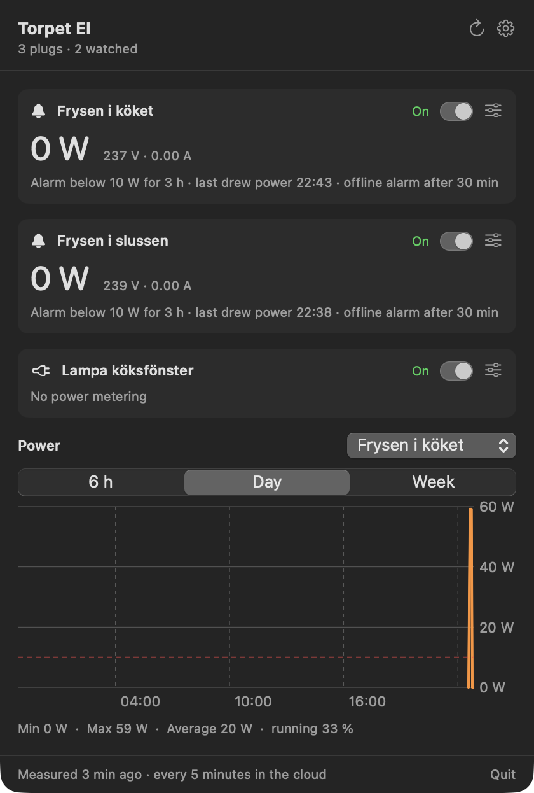

# Torpet El

A macOS menu bar app that watches the Tuya/Smart Life smart plugs at our summer cottage ("torpet") and raises an
alarm when a freezer stops drawing power. The watching itself runs in AWS (see [cloud/](cloud/README.md)), so alarms
reach your phone through ntfy even when the Mac is asleep or off. The app shows what the cloud sees.

<p align="center"></p>

The menu bar shows the watched plugs' current power, for example `⚡ 84 W  63 W`, and switches to `⚠` and the
plug's name when something is wrong. Click it to see:

- **Every plug**: on/off switch, online status, power, voltage and current.
- **Alarm settings** per plug: below how many watts it counts as having no power, how long it may stay that way,
  and whether to alarm when the plug goes offline (power cut, tripped fuse, network down at the cottage).
- **A power chart** for the last 6 hours, day or week, with the alarm limit and how much of the time the
  compressor ran.

Alarms are sent to the phone through ntfy and as macOS notifications, and again when the plug recovers.

Switching off a watched plug (a freezer) asks for confirmation first, so a misclick can't turn the freezer off.

## How the alarm works

Every five minutes a Lambda function fetches the plugs from Tuya's cloud API and saves the readings in DynamoDB. A
freezer's compressor stands still between cycles, so the alarm fires only when the plug has stayed below the limit
(default 10 W) for a whole period (default 3 hours). A gap of more than 20 minutes between readings restarts the count,
so a period where nothing was observed never causes an alarm. If Tuya stops answering for 30 minutes, for example
when the IoT Core trial has expired, that alarms too.

Plugs whose name contains "frys" or "freezer" are watched from the start; the rest can be switched on under the
slider icon on each plug. The alarm settings are saved in the cloud.

Note: in a cold cottage in winter a freezer can legitimately stand still for many hours. Raise the hours if you
get alarms that aren't real.

## Build and install

```bash
./build.sh            # builds build/TorpetEl.app
./build.sh install    # copies it to ~/Applications and launches it
```

Requires macOS 14 or later and Xcode or the Command Line Tools. Launch at login is in the settings. macOS asks
for permission to show notifications the first time the app starts; say yes, and use **Test notification** in the
settings to check that they arrive.

## Setup

1. Move the plugs to the Tuya **Smart Life** app (brand apps such as Nedis SmartLife can't be linked).
2. At <https://platform.tuya.com> create a cloud project (Smart Home) with the **Central Europe** data center
   for an account registered in Sweden.
3. Under **Devices → Link App Account**, scan the QR code with Smart Life (Me → scan icon).
4. Set up the cloud part as described in [cloud/README.md](cloud/README.md). It asks for the project's **Access ID**
   and **Access Secret**, and prints an ntfy topic to subscribe to on the phone and an API key.
5. Paste the Function URL and API key into the app's settings.

The free IoT Core trial has to be extended now and then under **Cloud → Cloud Services**; you get an alarm when it
expires. The URL and key are stored in `~/Library/Application Support/TorpetEl/cloud.json` (readable only by you).

## Files

| File | Contents |
|---|---|
| `Sources/TorpetEl/Cloud.swift` | Client for the cloud API, and the plug model |
| `Sources/TorpetEl/Alarm.swift` | Alarm settings and status, and notifications |
| `Sources/TorpetEl/PlugStore.swift` | Fetching from the cloud, switching, alarm notifications, the menu bar text |
| `Sources/TorpetEl/Views.swift` | The popover: plugs, alarm settings, chart, settings |
| `Sources/TorpetEl/Format.swift`, `Language.swift` | Formatting, and the language setting (Swedish or English) |
| `cloud/` | The Lambda function, its CloudFormation stack and setup scripts |
